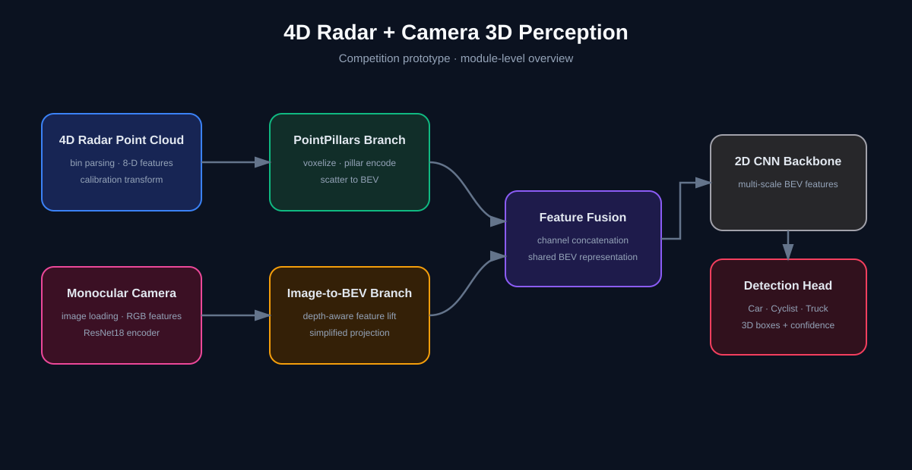
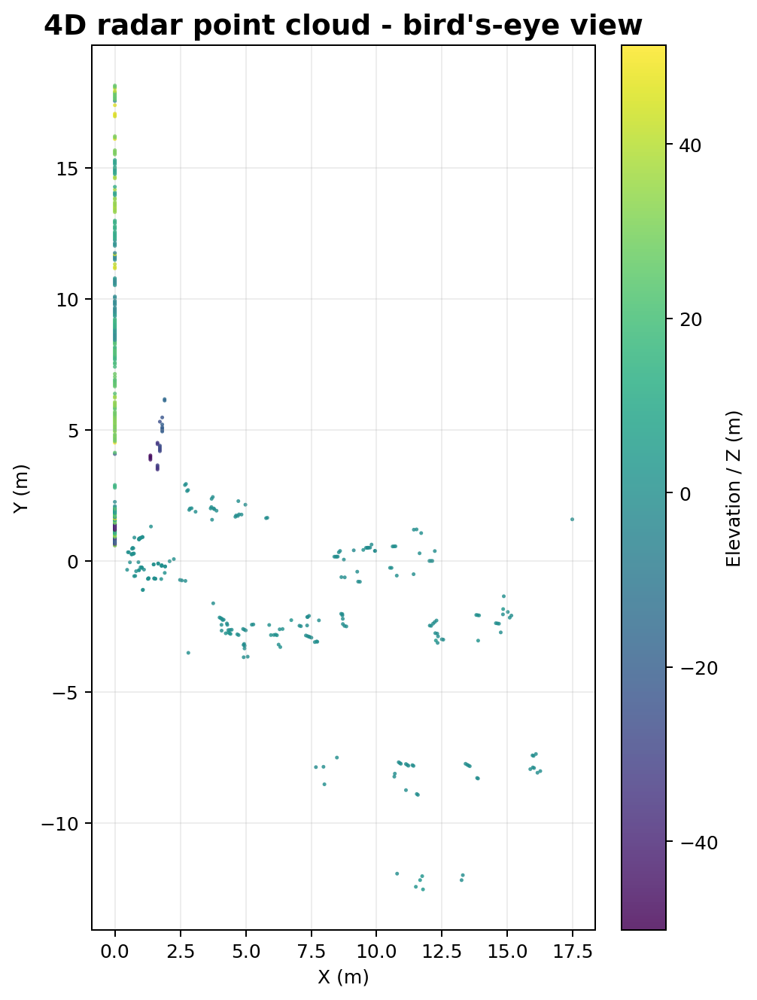

# 4D Radar + Camera 3D Perception

> A research and competition prototype for 3D object detection from 4D millimeter-wave
> radar point clouds, with an optional monocular-camera fusion branch.



## Overview

This repository organizes the implementation from a 2025 intelligent-driving competition
prototype. The system studies how a PointPillars-style point-cloud detector and a
camera-derived BEV feature branch can be combined for **Car**, **Cyclist**, and **Truck**
detection.

The repository is a cleaned presentation snapshot. It focuses on the data pipeline,
model architecture, training/evaluation code, and visualization utilities. It is not
presented as a production self-driving system.

## At a glance

| Item | Description |
|---|---|
| Input | 8-channel 4D mmWave radar point clouds and monocular images |
| Point-cloud branch | Pillar encoding, BEV scatter, 2D CNN backbone |
| Image branch | ResNet18 feature extraction and simplified depth-aware BEV lifting |
| Output | Per-class 3D boxes and confidence scores |
| Classes | Car, Cyclist, Truck |
| Context | AIC 2025 team competition prototype, completed in 2025 |



## Architecture

```text
4D radar points ──> calibration / feature construction ──> PointPillars branch ─┐
                                                                                ├─> BEV fusion
monocular image ──> ResNet18 encoder ──> simplified lift/splat branch ──────────┘
                                                                                │
                                                                                v
                                                                 2D CNN backbone + head
                                                                                │
                                                                                v
                                                                    3D boxes and classes
```

The camera BEV branch is intentionally documented as a **simplified
Lift-Splat-Shoot-inspired implementation**. It averages lifted depth features and resizes
them to the BEV grid; it is not a full geometric LSS implementation.

## Repository layout

```text
src/
├── data/              # Dataset, calibration, and bin parsing
├── models/            # Lidar-only and camera-fusion models + losses
├── pipeline/          # Train, evaluation, and demo entry points
└── visualization/     # 2D / 3D point-cloud helpers and BEV preview
configs/default.py     # Dataset root, classes, and visualization defaults
examples/              # Small public sample inputs
docs/                  # Design, results context, and limitations
assets/                # Architecture and preview images
```

## Quick start

The original competition dataset is not bundled. Place a compatible DRad/KITTI-style
dataset outside this repository and point `DRAD_DATASET_ROOT` to it.

```powershell
python -m venv .venv
.\.venv\Scripts\python -m pip install -r requirements.txt
$env:DRAD_DATASET_ROOT = "D:\datasets\DRadDataset"

# Lidar-only training
python -m src.pipeline.train_lidar

# Camera-fusion training
python -m src.pipeline.train_fusion

# Evaluation
python -m src.pipeline.evaluate

# Dataset/point-cloud demo
python -m src.pipeline.demo --num_frames 3
```

The dataset layout expected by the code is documented in
[`docs/ARCHITECTURE.md`](docs/ARCHITECTURE.md).

## Scope and results

This is a retrospective code organization pass. No new training, tuning, metric
selection, or leaderboard claim was performed. See
[`docs/RESULTS.md`](docs/RESULTS.md) for the available project context and the boundary
between historical artifacts and verified metrics.

## Known limitations

- Camera-to-BEV projection is simplified and should not be described as full LSS.
- The original dataset and checkpoint weights are not redistributed.
- The current code is a competition prototype rather than a production system.
- Evaluation thresholds and post-processing in the historical runs were not re-tuned.

See [`docs/LIMITATIONS.md`](docs/LIMITATIONS.md) for details.

## License and third-party work

The code in this repository is released under the MIT License. Dataset access and any
third-party model or library usage remain subject to their original terms. See
[`docs/THIRD_PARTY_NOTICES.md`](docs/THIRD_PARTY_NOTICES.md).
